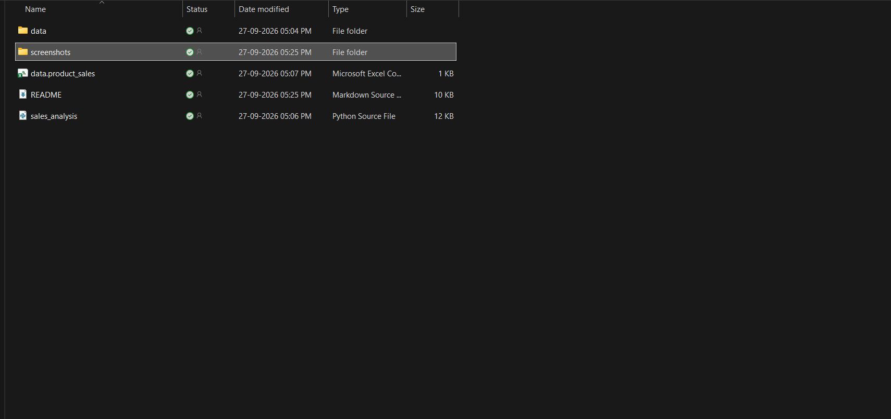
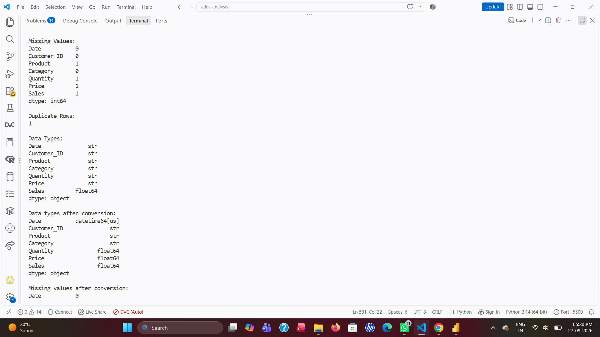
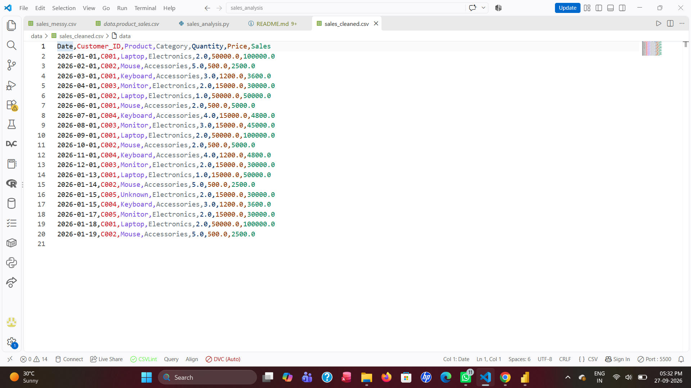
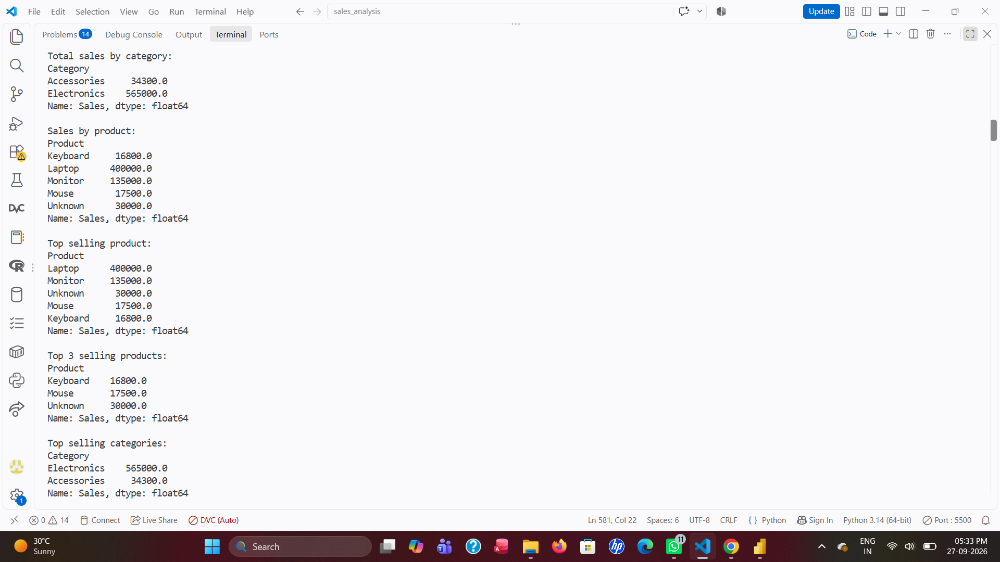
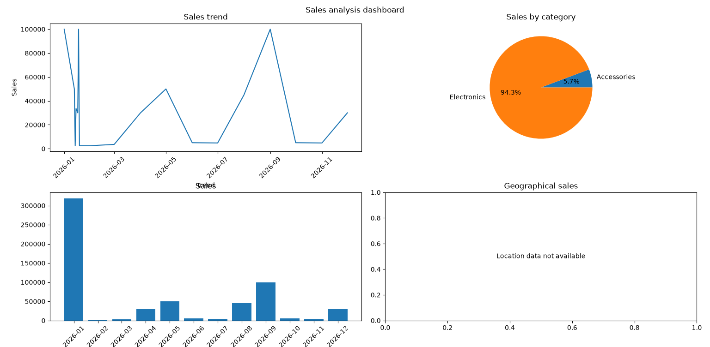
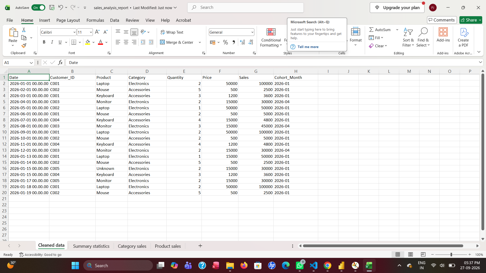
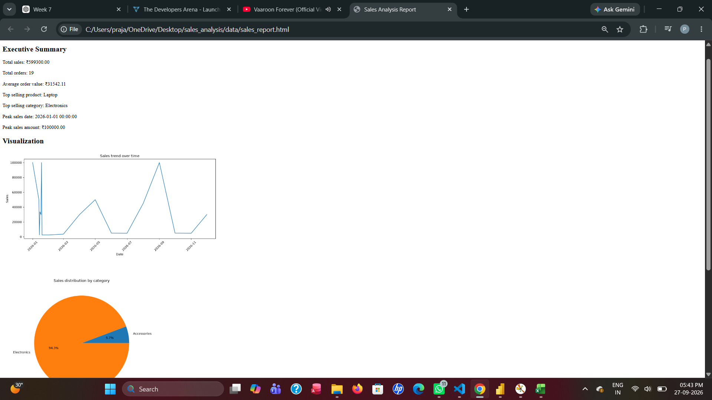

1. Project Overview and Objectives

Project Overview

The Sales Analysis Project is a Python-based data analysis project that analyzes sales data using **Pandas, NumPy, and Matplotlib**.

The project uses a messy sales dataset, cleans the data, performs basic and advanced analysis, creates visualizations, and generates reports.

Objectives

The main objectives of this project are:

* Load and explore sales data from a CSV file.
* Identify missing values and data quality issues.
* Clean and prepare the dataset for analysis.
* Analyze sales by product and category.
* Analyze sales trends over time.
* Calculate monthly sales growth.
* Analyze customer purchase patterns.
* Calculate customer lifetime value metrics.
* Generate a simple sales forecast using a moving average.
* Create sales visualizations.
* Generate CSV and Excel reports.
* Create an HTML sales report.

---

2. Setup and Installation Instructions

Requirements

The project requires:

* Python 3.x
* Pandas
* NumPy
* Matplotlib
* OpenPyXL

Install Required Packages

Open the VS Code terminal and run:

pip install pandas numpy matplotlib openpyxl

Project Setup

Create the following project structure:


sales_analysis/
│
├── data/
│   ├── sales_messy.csv
│   ├── sales_cleaned.csv
│   ├── summary_statistics.csv
│   ├── category_sales.csv
│   ├── product_sales.csv
│   ├── executive_summary.txt
│   ├── sales_analysis_report.xlsx
│   ├── sales_trend.png
│   ├── category_sales.png
│   ├── monthly_sales.png
│   └── sales_report.html
│
├── sales_analysis.py
│
└── README.md

Run the Application

Open the terminal inside the `sales_analysis` folder and run:

python sales_analysis.py

The program will perform data cleaning, analysis, visualization, and reporting.


3. Code Structure Explanation

`sales_analysis.py`

This is the main Python file containing the complete sales analysis workflow.

`data/sales_messy.csv`

Contains the original messy sales data.

The dataset contains data quality problems such as:

* Missing values
* Duplicate records
* Incorrect numeric values
* Different date formats
* Inconsistent category names
* Negative values

`data/sales_cleaned.csv`

Contains the cleaned dataset after handling the data quality problems.

Generated Reports

The program generates:

* `summary_statistics.csv` — summary statistics
* `category_sales.csv` — sales by category
* `product_sales.csv` — sales by product
* `executive_summary.txt` — key business insights
* `sales_analysis_report.xlsx` — Excel report
* `sales_report.html` — HTML report

Visualizations

The program generates:

* `sales_trend.png` — sales trend line chart
* `category_sales.png` — category sales pie chart
* `monthly_sales.png` — monthly sales bar chart


4. Screenshots of Working Application

Screenshot 1: Project Structure

Add a screenshot showing:
<!-- 
```text
sales_analysis/
├── data/
├── notebooks/
├── sales_analysis.py
└── README.md
```

Example:

```markdown -->


Screenshot 2: Data Exploration

Take a screenshot showing the terminal output containing:



Screenshot 3: Data Cleaning
<!-- 
Take a screenshot showing the cleaned dataset or terminal output after cleaning.

```markdown -->


Screenshot 4: Sales Analysis

<!-- Take a screenshot showing:

* Total sales by category
* Top-selling products
* Monthly sales
* Average order value

```markdown -->


Screenshot 5: Visualization Dashboard
<!-- 
Take a screenshot of the Matplotlib dashboard.

```markdown -->


Screenshot 6: Excel Report

<!-- Take a screenshot of:

```text
sales_analysis_report.xlsx
```

showing the different sheets.

```markdown -->


Screenshot 7: HTML Report

<!-- Take a screenshot of the `sales_report.html` opened in a browser.

```markdown -->


5. Technical Requirements

The following technical requirements were completed:

| Requirement             | Implementation                                                                         |
| ----------------------- | -------------------------------------------------------------------------------------- |
| Python                  | Used Python for the complete project                                                   |
| Pandas                  | Used for loading, cleaning, grouping, and analyzing data                               |
| NumPy                   | Used for numerical operations                                                          |
| Matplotlib              | Used for creating visualizations                                                       |
| CSV                     | Used as the input and output data format                                               |
| Data Cleaning           | Missing values, duplicates, incorrect data types, and inconsistent values were handled |
| Date Conversion         | Date values were converted to datetime format                                          |
| Product Analysis        | Sales were analyzed by product                                                         |
| Category Analysis       | Sales were analyzed by category                                                        |
| Customer Analysis       | Customer purchase patterns were analyzed using `Customer_ID`                           |
| Cohort Analysis         | Customer cohort month was calculated                                                   |
| Customer Lifetime Value | Basic customer lifetime value metrics were calculated                                  |
| Sales Growth            | Monthly sales growth rates were calculated                                             |
| Forecasting             | Three-month moving average was used for simple forecasting                             |
| Visualization           | Line, pie, and bar charts were created                                                 |
| Dashboard               | Multiple charts were combined into a dashboard                                         |
| Excel Report            | Analysis results were exported to Excel                                                |
| CSV Reports             | Analysis results were exported to CSV                                                  |
| HTML Report             | An HTML report was generated                                                           |
| Image Export            | Visualizations were saved as PNG files                                                 |

---

6. Data Cleaning Process

The following cleaning operations were performed:

1. Missing product and category values were handled.
2. Missing numerical values were handled using appropriate values.
3. Duplicate records were removed.
4. Date formats were standardized.
5. Numeric columns were converted to numeric data types.
6. Invalid numeric values such as `"ten"` were converted to missing values.
7. Product names were standardized.
8. Category names were standardized.
9. Negative quantity and sales values were handled.
10. The cleaned dataset was saved as `sales_cleaned.csv`.

---

7. Analysis Performed

The project performs the following analysis:

Basic Analysis

* Total sales by product category
* Top-selling products
* Top-selling categories
* Daily sales trends
* Monthly sales
* Average order value
* Peak sales periods

Advanced Analysis

* Monthly sales growth rate
* Customer purchase patterns
* Customer cohort analysis
* Customer lifetime value
* Three-month moving average sales forecast

---

8. Visualizations

The project creates the following visualizations:

Sales Trend

A line chart showing sales changes over time.

Category Sales

A pie chart showing the percentage contribution of each product category.

Monthly Sales

A bar chart comparing monthly sales.

Sales Dashboard

A dashboard containing multiple charts for quick analysis.

---

9. Reports Generated

The project generates the following reports:

summary_statistics.csv
category_sales.csv
product_sales.csv
executive_summary.txt
sales_analysis_report.xlsx
sales_report.html


These reports provide both detailed analysis and a summary of important sales insights.

---

10. Conclusion

The Sales Analysis Project demonstrates the complete data analysis workflow, from loading and cleaning raw sales data to performing analysis, creating visualizations, and generating reports.

The project provides useful insights into product performance, category performance, sales trends, customer behavior, and sales forecasting.

The project also demonstrates practical use of **Python, Pandas, NumPy, Matplotlib, CSV, Excel, and HTML reporting**.
